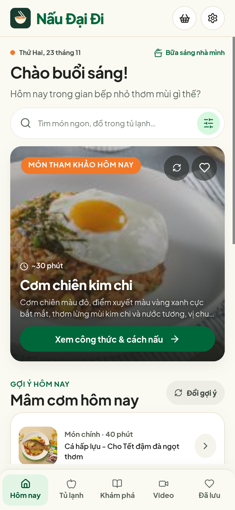

# Nấu Đại Đi

**Trợ lý bếp giúp bạn biết nấu gì từ những nguyên liệu đang có.** Thêm đồ vào tủ lạnh, xem gợi ý món phù hợp, lưu món yêu thích và tìm video hướng dẫn nấu ăn.

**Dùng thử:** [naudaidi.vercel.app](https://naudaidi.vercel.app/)



*Giao diện điện thoại, ảnh chụp ngày 23-11-2026.*

## Ứng dụng làm gì?

- **Tủ lạnh:** lưu nguyên liệu, số lượng, tình trạng và hạn dùng ngay trên thiết bị.
- **Gợi ý món:** tìm món theo nguyên liệu sẵn có, xem món còn thiếu gì và cách nấu.
- **Video:** khám phá các video nấu ăn YouTube; danh sách được làm mới hằng ngày. Video đã xem được ghi nhớ trên thiết bị để ưu tiên nội dung chưa xem.
- **Lưu và theo dõi:** đánh dấu món yêu thích, món đã nấu, danh sách mua sắm và lịch sử xem.
- **Dùng không cần tài khoản:** dữ liệu cá nhân của các tính năng trên được lưu trong trình duyệt trên thiết bị. Có thể xuất/nhập bản sao lưu JSON trong **Sở thích → Sao lưu dữ liệu trên thiết bị**. Xóa dữ liệu trình duyệt có thể làm mất dữ liệu chưa sao lưu.

## Thiết bị

Nấu Đại Đi được thiết kế **ưu tiên điện thoại** và có thể cài như PWA trên trình duyệt hỗ trợ. Trên máy tính, app vẫn mở được bằng giao diện web co giãn; trải nghiệm desktop riêng chưa phải trọng tâm thiết kế.

## Video YouTube được cập nhật thế nào?

GitHub Actions làm mới catalog mỗi ngày lúc **09:00 giờ Việt Nam (UTC+7)**, tương đương **02:00 UTC**. Khi có thay đổi, workflow commit catalog vào GitHub và Vercel triển khai lại dữ liệu mới. Lịch này cập nhật danh sách dùng chung cho mọi người; lịch sử video đã xem vẫn được lưu riêng trên thiết bị của từng người.

Catalog production được kiểm tra ngày **23-11-2026**: 374 bản ghi, gồm 239 video được chấp nhận tự động và 135 mục cần review. Số liệu có thể đổi sau những lần đồng bộ tiếp theo; trạng thái được chấp nhận không bảo đảm mọi video luôn phát được.

## Dành cho người phát triển

> Các bước dưới đây chỉ cần nếu bạn muốn chạy mã nguồn hoặc tự quản lý quy trình cập nhật YouTube. Người dùng thông thường chỉ cần mở ứng dụng ở liên kết phía trên.

### Chạy ứng dụng trên máy

Yêu cầu Node.js 22.6 trở lên.

```bash
git clone https://github.com/myduyen2104/nau-dai.git
cd nau-dai
npm ci
npm run dev
```

### Build và kiểm tra

```bash
npm test
npm run validate:recipes
npm run build
```

Production dùng Vercel với `npm run build`, thư mục output `dist` và cấu hình trong [`vercel.json`](vercel.json). Mỗi commit lên `main` sẽ kích hoạt deployment.

### Cấu hình đồng bộ video YouTube

Để GitHub Actions gọi YouTube Data API, repository cần secret tên `YOUTUBE_API_KEY`. Bật YouTube Data API v3 trong Google Cloud, tạo và giới hạn API key phù hợp, sau đó thêm key tại **GitHub → Settings → Secrets and variables → Actions**. Không đưa key vào frontend hoặc biến `VITE_*`. Workflow tiêu thụ quota API; hiện giới hạn tối đa 24 lệnh `search.list` cho mỗi lần chạy. Có thể chạy thủ công tại **Actions → Update YouTube food videos → Run workflow**.

TikTok và Facebook không được crawl tự động. Ứng dụng cho phép lưu liên kết video để xem sau.

## Dữ liệu và ghi nhận nguồn

Source hiện có 37 công thức nội bộ và 140 nguyên liệu cho tủ lạnh/gợi ý. Recommendation engine chạy trong trình duyệt. Ba công thức Copper trong thư viện Khám phá (Bánh xèo, Bún chả, Phở bò) có ghi attribution và license trong ứng dụng. Công thức tự phối được đánh dấu chưa thử nghiệm; không xem dữ liệu thiếu định lượng là khẩu phần đã xác nhận.

Tình trạng nguồn, license và quyết định sử dụng được ghi trong [`source-audit.json`](source-audit.json). Những nguồn không nêu quyền tái sử dụng không được mặc định xem là có thể phân phối lại. Quy trình dữ liệu Copper và QA được ghi trong [`docs/`](docs/).

## Giấy phép

Repository hiện chưa có một giấy phép mã nguồn áp dụng chung. Dữ liệu công thức, hình ảnh và nội dung từ bên thứ ba có điều khoản riêng; xem [`source-audit.json`](source-audit.json) và ghi nhận attribution trong ứng dụng trước khi tái sử dụng.
